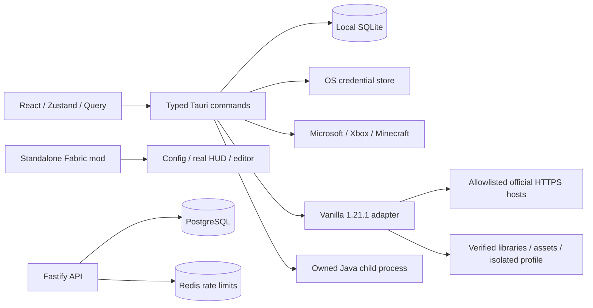

# Hera architecture · ADR 001

## Product boundary

Hera is an independent Java Edition client ecosystem. NoRisk and Lunar are functional references only. No source code, skins, imagery or layout assets have been copied. The initial target is Minecraft 1.21.1, Java 21, x86_64, vanilla/Fabric/Forge launcher adapters and a separately built Fabric client. A target is **experimental** until authenticated installation, start and gameplay have been observed. Current support status is in [status.md](status.md).

## Reference analysis (25 October 2026)

| Primary reference | Observed capability | Technical purpose / Hera decision |
|---|---|---|
| [NoRisk](https://norisk.gg/) | Isolated profiles, HUD editor, cosmetics, mod search, friends, hosted worlds | Separate launcher profiles, client modules and online service boundaries; implement local workflows first |
| [NoRisk launcher repository](https://github.com/NoRiskClient/noriskclient-launcher) | Tauri / React / Rust, GPL-3.0 | Architectural reference only. Do not copy GPL implementation into this project |
| [Lunar features](https://www.lunarclient.com/features) | Bundled configurable mods, multiple OS targets, optional performance mods | Independently versioned game adapters; benchmark performance without repeating marketing claims |
| [Fabric documentation](https://docs.fabricmc.net/1.21.1/develop/) | Loader, client lifecycle / HUD callbacks, keybindings | A standalone client-only mod; no launcher dependency |
| [Modrinth API](https://docs.modrinth.com/api/) | Version / loader metadata, downloads, dependencies | Resolve an install graph before writing mods; future integration uses official API and identifying User-Agent |
| [Tauri 2](https://v2.tauri.app/security/) | Capabilities and IPC security | No shell, generic filesystem, HTTP or arbitrary process plugin exposed to web content |
| [Microsoft device authorization](https://learn.microsoft.com/en-us/entra/identity-platform/v2-oauth2-device-code) | Public-client device flow and refresh | App-owned registration; OS keychain refresh credentials; native-only token exchange |
| [Minecraft EULA](https://www.minecraft.net/en-us/eula) | Independent tools allowed within conditions; no unrestricted redistribution of game software | Download Mojang files on user's machine, never include them in the repository or releases |

The commercial references describe capabilities, not evidence that our implementation performs equivalently. Licensing and terms review is preliminary engineering research, not release legal approval. Minecraft/Xbox application eligibility must be confirmed for our own client registration.

## Boundaries and data flow

`packages/shared-types` owns profile/settings contracts and boundary validation. React owns presentation and orchestration, never tokens. Query owns async data and invalidation; Zustand owns navigation/selection. Browser preview is explicitly marked and uses separate localStorage data. Native storage uses SQLite WAL with parameterized SQL; account rows contain only public UUID/name. Refresh tokens live in native OS credential store, Minecraft access tokens remain in Rust memory. Game arguments are never logged.

The native installer resolves metadata from the official Mojang index, verifies version JSON against the advertised hash, then verifies asset index, JARs and assets by size/SHA-1. SHA-1 is retained to match Mojang's published format, not chosen for new authentication. HTTPS origin allowlisting, disabled redirects, bounded bodies, unique temporary files, restricted relative paths, bounded parallelism and bounded retries form the trust boundary. A failed install is retried safely and existing valid artifacts are reused. Resume-by-range, cancellation and download speed/ETA are future work.

Game creation uses direct argument vectors without a shell. One installation/start and one child process at a time. Authentication and ownership checks precede launch. Java 21 is mandatory. Custom JVM arguments are intentionally not accepted until a constrained parser exists. A process exit event updates the UI; raw stdout/stderr are not captured to avoid credential leakage. Minecraft's own per-profile logs remain available on disk. Native stop kills the owned process; graceful save/shutdown is future work.

Future `VersionAdapter` implementations must independently own metadata merge, dependency rules, Java requirements, install plan, launch arguments and acceptance evidence. Do not turn a catalog entry into a support badge. Modern vanilla, Fabric 0.16.14 and Forge 52.1.20 have experimental 1.21.1 adapters with real installation tests. Authenticated launch and gameplay remain acceptance gates. NeoForge/legacy adapters and automatic distribution of the Hera Fabric mod remain open. The mod browser supports Modrinth directly and CurseForge through a server-key gateway; see [mods.md](mods.md).

## Backend

The implemented service exposes liveness/readiness and an authenticated, revisioned settings resource. Identity comes from live Minecraft profile verification, never request bodies. PostgreSQL uses compare-and-swap writes to reject concurrent overwrites. Redis rate limiting fails closed. No plaintext bearer token is cached or logged. No unauthenticated settings endpoint. Services bind loopback by default; deploy behind TLS ingress. Current service is not connected to the launcher UI.

Before wider online delivery: issue short-lived Hera sessions after Minecraft identity proof; Redis revocation, WebSocket origin validation and per-message authorization, blocked-user enforcement, moderation, asset sanitization and signed delivery URLs. Defaults: no public server presence, no discoverable child accounts, friends-only sharing after opt-in. Relay invitations should be short-lived, bound to UUID and relay session, with host ACL enforcement. Relay must never reveal host IP; bandwidth is proportional to active sessions × throughput × duration × relay legs. No provider costs are quoted without actual traffic and a selected provider. All require operated external infrastructure and monitoring.

## Design system

Graphite backgrounds (#0d0d12/#141319), violet accent (#aa92fa), optional cyan, low contrast borders, 6–12px corners, restrained 18–24px icons. CSS-generated landscape is original and carries no third-party game assets. Components: primary/secondary/icon buttons, profile cards, native selects, modal with browser focus trap/Esc, toggle with switch semantics, range slider, status notification and empty state. OS reduced-motion preference plus local override. Text sizes scale through root rem values. Full color picker, tooltip system and 3D skin viewer remain planned.

## Delivery gates

1. TS typecheck, API/schema tests, web production build, Rust check/tests, Java build/tests.
2. Install/reinstall, corrupt-file repair, no-auth rejection, successful app-owned Microsoft login and launch on Windows.
3. Fabric HUD/editor tested in actual world, config persistence/reopen, UI scaling, low-resolution clipping checks.
4. Linux/macOS gameplay and installer/signing checks, dependency license inventory, threat review, benchmark recordings.
5. Signed releases and signed updater with rollback tested on each supported platform. Never publish development artifacts as stable.
